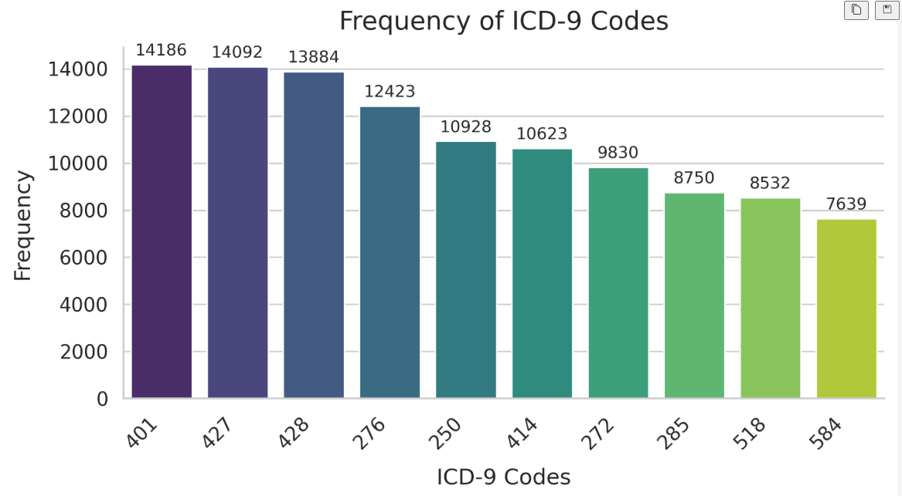

<div align="center">

# REMEDI: A Benchmark for Retention and Unlearning Evaluation in Multi-label Clinical Disease Inference

Anurag Sharma<sup>1</sup>, Sai Teja Chunchu<sup>1</sup>, Prasenjit Mitra<sup>2</sup>, Sandipan Sikdar<sup>3</sup>, Koustav Rudra<sup>1</sup>

<sup>1</sup>IIT Kharagpur, India &nbsp; <sup>2</sup>Carnegie Mellon University Africa, Rwanda &nbsp; <sup>3</sup>L3S Research Center, Leibniz University Hannover, Germany

**CIKM 2026** · Rome, Italy

[](https://dl.acm.org/doi/10.1145/3799682.3840213)
[](https://arxiv.org/abs/2606.07141)
[](#setup)
[](https://physionet.org/content/mimiciii/1.4/)

</div>

This is the official code for our CIKM 2026 paper. REMEDI is a benchmark for machine unlearning on clinical text: a model that predicts ICD-9 diagnoses from admission notes has to forget specific patients on request, without losing what it learned from everyone else. We built it on MIMIC-III and use it to evaluate six unlearning methods across three deletion scenarios.

## Updates

- **Nov 2026**: Paper published in the CIKM '26 proceedings ([ACM DL](https://dl.acm.org/doi/10.1145/3799682.3840213)).
- **Jun 2026**: Preprint (long version) released on [arXiv](https://arxiv.org/abs/2606.07141).

## Contents

- [Overview](#overview)
- [Repository structure](#repository-structure)
- [Setup](#setup)
- [Preparing the data](#preparing-the-data)
- [Running the baselines](#running-the-baselines)
- [Evaluation](#evaluation)
- [Results](#results)
- [Citation](#citation)

## Overview

Clinical language models are trained on patient records, and patients (or data owners) can ask for their records to be removed. Retraining from scratch every time is expensive, so approximate unlearning methods are attractive. Most of them, however, were designed and tested on image classification or synthetic data, usually in a single-label setting.

REMEDI tests them in a harder setting:

- the task is **multi-label** disease inference over ten frequent ICD-9 categories, where labels are correlated (e.g. diabetes and coronary artery disease);
- the inputs are **real admission notes** from MIMIC-III, not synthetic records;
- forget requests come at **three severity levels**, including a case where the patients to be forgotten look a lot like patients who stay in the training set;
- each method is scored on **utility** (macro-F1 on test, retain and forget sets) and on **privacy** (a membership inference attack).

The main finding is that there is a clear trade-off between keeping utility and actually forgetting. Methods that work for a handful of patients often break down when a few percent of the training set has to go, and most methods are not well suited to the multi-label case.

### Task and labels

The input is the admission-time portion of a discharge summary (chief complaint, history of present illness, medical history, admission medications, allergies, physical exam, family history and social history), following van Aken et al. (2021). ICD-9 codes are collapsed to their three-character category and the ten most frequent categories are kept:

| Code | Condition | Code | Condition |
| :-: | :-- | :-: | :-- |
| 401 | Essential hypertension | 414 | Coronary artery disease |
| 427 | Cardiac dysrhythmias | 272 | Disorders of lipid metabolism |
| 428 | Heart failure | 285 | Other anemias |
| 276 | Fluid / electrolyte disorders | 518 | Respiratory failure and other lung disease |
| 250 | Diabetes mellitus | 584 | Acute kidney failure |

<p align="center">
  
</p>

| Split | Records |
| :-- | --: |
| Train | 30,257 |
| Validation | 1,168 |
| Test | 6,325 |
| Holdout (used only for the membership inference attack) | 1,500 |
| **Total** | **39,250** |

### Forget scenarios

| Scenario | Severity | Forget set size | What it simulates |
| :-- | :-: | :-- | :-- |
| Distinct instances | Low | K = 64, 128, 256, 512 | Randomly chosen patients with no near-duplicates in the retain set |
| Concurrent instances | Medium | K = 64, 128, 256 | Half of the forget set is similar to records that stay in the retain set |
| Large-scale instances | High | 3%, 4%, 5% of train (907 / 1,210 / 1,513 records) | Bulk deletion requests |

### Unlearning methods

| Method | Script | Notes |
| :-- | :-- | :-- |
| Gradient Ascent (GA) | `code/ul_ga_without_retain.py` | Gradient ascent on the forget set only |
| Gradient Ascent + Retain (GA+R) | `code/ul_ga_with_retain.py` | Gradient ascent on forget, descent on a sample of the retain set |
| Adversarial Unlearning (AU) | `code/ul_adv.py` | Cha et al., AAAI 2024 |
| AU + Weight Regularization (AU+WR) | `code/ul_adv_imp.py` | AU plus an importance-weighted penalty on parameter drift (Cha et al.) |
| Bad Teacher (BT) | `code/ul_bad_teacher.py` | Chundawat et al., AAAI 2023 |
| SCRUB | `code/ul_scrub.py` | Kurmanji et al., NeurIPS 2023 |

All methods are applied to fine-tuned **BioLinkBERT** and **BioBERT** classifiers. *Original* is the fine-tuned model before unlearning and *Retrain* is a model trained from scratch without the forget set, which serves as the reference.

## Repository structure

```
REMEDI/
├── code/
│   ├── utils.py                  # dataset class, loaders, loss, metrics, PGD attack, importance estimation
│   ├── ul_ga_without_retain.py   # GA
│   ├── ul_ga_with_retain.py      # GA+R
│   ├── ul_adv.py                 # AU
│   ├── ul_adv_imp.py             # AU+WR
│   ├── ul_bad_teacher.py         # BT
│   └── ul_scrub.py               # SCRUB
├── dataset/
│   ├── make_data.py              # builds the 10-label dataset from preprocessed MIMIC-III notes
│   ├── make_bench.py             # samples the distinct / concurrent / large-scale forget sets
│   └── sample EHR.txt            # one de-identified example input
├── figures/
│   └── frequency.png
├── demo.ipynb                    # walk-through of the evaluation loop
└── requirements.txt
```

## Setup

We used Python 3.12 and PyTorch 2.8 with CUDA 12.6. Experiments were run on NVIDIA GPUs; the scripts wrap models in `nn.DataParallel` and will use all visible GPUs.

```bash
git clone https://github.com/anuragiiser/REMEDI.git
cd REMEDI

conda create -n remedi python=3.12 -y
conda activate remedi

# PyTorch built for CUDA 12.6 (change the index URL for a different CUDA version)
pip install torch==2.8.0 --index-url https://download.pytorch.org/whl/cu126
pip install -r requirements.txt
```

## Preparing the data

MIMIC-III is a credentialed-access database, so we cannot redistribute the notes. To build the benchmark:

1. Get access to [MIMIC-III v1.4](https://physionet.org/content/mimiciii/1.4/) on PhysioNet (this needs CITI training and signing the data use agreement).
2. Extract the admission-note sections and ICD-9 codes for each admission, following the clinical outcome prediction setup of [van Aken et al. (2021)](https://github.com/bvanaken/clinical-outcome-prediction). The result should have the columns `id`, `Symptoms`, `text` and `short_codes`.
3. Run `dataset/make_data.py` to collapse the codes to three characters and keep the ten most frequent categories. This writes the `icd9_codes` column.
4. Run `dataset/make_bench.py` to draw the forget sets. It writes JSON files mapping each forget-set size to a list of row indices in `mimic.csv`.

Both scripts in `dataset/` still contain the absolute paths we used locally, so edit them to point to your copy of the data before running.

The unlearning scripts expect the following layout relative to the directory you run them from:

```
data/
├── mimic.csv          # training set (forget and retain sets are drawn from here)
├── mimic_val.csv
├── mimic_test.csv
└── forget_set.json    # {"64": {"fold_1": [...], "fold_2": [...], "fold_3": [...]}, "128": {...}, ...}
best_model/
└── biolinkbert/       # fine-tuned checkpoint saved with save_pretrained (tokenizer included)
```

Results are averaged over three folds (`TRIALS = 3` in `code/utils.py`), with seeds 42, 43 and 44, so each size in `forget_set.json` should contain `fold_1`, `fold_2` and `fold_3`.

## Running the baselines

Every script takes the name of the model folder under `best_model/` and the path to a forget-set file:

```bash
python code/ul_ga_without_retain.py --model biolinkbert --forget_details_path data/forget_set.json
python code/ul_ga_with_retain.py    --model biolinkbert --forget_details_path data/forget_set.json
python code/ul_adv.py               --model biolinkbert --forget_details_path data/forget_set.json
python code/ul_adv_imp.py           --model biolinkbert --forget_details_path data/forget_set.json
python code/ul_scrub.py             --model biolinkbert --forget_details_path data/forget_set.json
```

Bad Teacher also needs the incompetent teacher, i.e. a model with the same architecture that has not been trained on the task:

```bash
python code/ul_bad_teacher.py --model biolinkbert \
    --forget_details_path data/forget_set.json \
    --naive_model_path best_model/biolinkbert_untrained/
```

For each forget-set size and fold, the checkpoint with the lowest forget-set F1 is saved to `unlearned/<model>/<method>/<K>/<fold>/`, and the averaged test, retain and forget scores are printed at the end.

### Hyperparameters

Shared settings live at the top of `code/utils.py`; method-specific ones are at the top of each script.

| Setting | Value |
| :-- | :-- |
| Optimizer | AdamW, gradient clipping at 1.0 |
| Learning rate | 1e-5 |
| Epochs | 4 |
| Batch size (forget / eval) | 32 / 256 |
| Max sequence length | 512 |
| Loss | Weighted BCE, positive weight clamped to [1, 100] |
| Retain samples per forget sample (GA+R) | 4 |
| GA+R | λ = 0.4 |
| AU | λ<sub>r</sub> = 0.7, λ<sub>f</sub> = 0.3 |
| AU+WR | λ<sub>r</sub> = 0.7, λ<sub>f</sub> = 0.3, λ<sub>w</sub> = 0.5 |
| PGD (AU, AU+WR) | ε = 0.15, step = 0.001, 35 steps, 4 adversarial samples per input |
| BT | KL temperature = 1 |
| SCRUB | γ = 0.6, α = 0.4, KD temperature = 1.5 |

## Evaluation

**Utility.** Macro-F1 over the ten labels (threshold 0.5) on three sets: the test set (generalization), the retain set (what should be kept) and the forget set (what should be removed). A good unlearned model should look like *Retrain* on all three, which means forget-set F1 should drop to roughly test-set level, not to zero.

**Privacy.** We train a logistic regression attacker to separate the per-sample losses of forget-set records from those of the 1,500 holdout records, using the unlearned model. We report the MIA score as 2·|accuracy − 0.5|, so 0 means the forgotten patients are indistinguishable from patients the model never saw, and higher means more leakage.

## Results

The tables below are for **BioLinkBERT**, averaged over three folds. BioBERT results are in the paper.

<details open>
<summary><b>Distinct instances (low severity)</b></summary>


**K = 64**

| Method | Test F1 | Forget F1 | Retain F1 | MIA ↓ |
| :-- | :-: | :-: | :-: | :-: |
| Original | 0.6042 | 0.6330 | 0.6314 | 0.0307 |
| Retrain | 0.6291 | 0.6216 | 0.6128 | 0.0692 |
| GA | 0.0739 | 0.0710 | 0.0757 | 0.1076 |
| GA+R | 0.6278 | 0.5906 | 0.6578 | 0.0076 |
| AU | 0.5210 | 0.4885 | 0.5538 | 0.0692 |
| AU+WR | 0.5266 | 0.5079 | 0.5513 | 0.0076 |
| BT | 0.4717 | 0.4749 | 0.4906 | 0.1230 |
| SCRUB | 0.6249 | 0.6673 | 0.6539 | 0.0153 |

**K = 128**

| Method | Test F1 | Forget F1 | Retain F1 | MIA ↓ |
| :-- | :-: | :-: | :-: | :-: |
| Original | 0.6042 | 0.6444 | 0.6313 | 0.0615 |
| Retrain | 0.5911 | 0.6014 | 0.6046 | 0.0499 |
| GA | 0.0547 | 0.0559 | 0.0545 | 0.1115 |
| GA+R | 0.6322 | 0.5984 | 0.6595 | 0.0307 |
| AU | 0.4723 | 0.4467 | 0.5059 | 0.0346 |
| AU+WR | 0.5096 | 0.5080 | 0.5397 | 0.0346 |
| BT | 0.4815 | 0.5058 | 0.5019 | 0.0384 |
| SCRUB | 0.6244 | 0.6606 | 0.6501 | 0.0730 |

**K = 256**

| Method | Test F1 | Forget F1 | Retain F1 | MIA ↓ |
| :-- | :-: | :-: | :-: | :-: |
| Original | 0.6042 | 0.6428 | 0.6313 | 0.0403 |
| Retrain | 0.5815 | 0.6011 | 0.6065 | 0.0154 |
| GA | 0.0633 | 0.0643 | 0.0626 | 0.0365 |
| GA+R | 0.6361 | 0.5983 | 0.6680 | 0.0500 |
| AU | 0.1979 | 0.2047 | 0.2400 | 0.0250 |
| AU+WR | 0.4041 | 0.4031 | 0.4350 | 0.0557 |
| BT | 0.4788 | 0.4720 | 0.4961 | 0.0173 |
| SCRUB | 0.6229 | 0.6480 | 0.6486 | 0.0019 |

**K = 512**

| Method | Test F1 | Forget F1 | Retain F1 | MIA ↓ |
| :-- | :-: | :-: | :-: | :-: |
| Original | 0.6042 | 0.6215 | 0.6316 | 0.0524 |
| Retrain | 0.5790 | 0.5982 | 0.5924 | 0.0203 |
| GA | 0.0484 | 0.0578 | 0.0472 | 0.0029 |
| GA+R | 0.6296 | 0.5923 | 0.6584 | 0.0572 |
| AU | 0.0168 | 0.0179 | 0.0199 | 0.0135 |
| AU+WR | 0.1638 | 0.2010 | 0.2180 | 0.0126 |
| BT | 0.4798 | 0.4855 | 0.4974 | 0.0271 |
| SCRUB | 0.5198 | 0.5226 | 0.5341 | 0.0165 |

</details>

<details>
<summary><b>Concurrent instances (medium severity)</b></summary>


**K = 64**

| Method | Test F1 | Forget F1 | Retain F1 | MIA ↓ |
| :-- | :-: | :-: | :-: | :-: |
| Original | 0.5388 | 0.5665 | 0.5690 | 0.0076 |
| Retrain | 0.5811 | 0.5459 | 0.5808 | 0.0230 |
| GA | 0.0598 | 0.0595 | 0.0611 | 0.0846 |
| GA+R | 0.5670 | 0.5067 | 0.5974 | 0.0307 |
| AU | 0.2823 | 0.2850 | 0.3216 | 0.0538 |
| AU+WR | 0.3207 | 0.3086 | 0.3555 | 0.0307 |
| BT | 0.4451 | 0.4575 | 0.4728 | 0.1076 |
| SCRUB | 0.5564 | 0.5810 | 0.5860 | 0.1000 |

**K = 128**

| Method | Test F1 | Forget F1 | Retain F1 | MIA ↓ |
| :-- | :-: | :-: | :-: | :-: |
| Original | 0.5388 | 0.5849 | 0.5690 | 0.0576 |
| Retrain | 0.5557 | 0.5389 | 0.5576 | 0.0384 |
| GA | 0.0320 | 0.0283 | 0.0314 | 0.1000 |
| GA+R | 0.5881 | 0.5450 | 0.6166 | 0.0346 |
| AU | 0.1449 | 0.1541 | 0.1765 | 0.0384 |
| AU+WR | 0.1916 | 0.2135 | 0.2278 | 0.0269 |
| BT | 0.4399 | 0.4557 | 0.4674 | 0.0653 |
| SCRUB | 0.5741 | 0.6111 | 0.5944 | 0.0423 |

**K = 256**

| Method | Test F1 | Forget F1 | Retain F1 | MIA ↓ |
| :-- | :-: | :-: | :-: | :-: |
| Original | 0.5388 | 0.5805 | 0.5689 | 0.0596 |
| Retrain | 0.5718 | 0.5693 | 0.5767 | 0.0570 |
| GA | 0.0473 | 0.0446 | 0.0455 | 0.0384 |
| GA+R | 0.6021 | 0.5620 | 0.6371 | 0.0384 |
| AU | 0.0676 | 0.0668 | 0.0699 | 0.0384 |
| AU+WR | 0.0757 | 0.0855 | 0.0861 | 0.0576 |
| BT | 0.4246 | 0.4147 | 0.4488 | 0.0250 |
| SCRUB | 0.5797 | 0.6086 | 0.6036 | 0.0538 |

</details>

<details>
<summary><b>Large-scale instances (high severity)</b></summary>


**K = 3%**

| Method | Test F1 | Forget F1 | Retain F1 | MIA ↓ |
| :-- | :-: | :-: | :-: | :-: |
| Original | 0.5388 | 0.5631 | 0.5692 | 0.0560 |
| Retrain | 0.5522 | 0.5407 | 0.5564 | 0.0103 |
| GA | 0.0216 | 0.0221 | 0.0212 | 0.0307 |
| GA+R | 0.1961 | 0.1800 | 0.2051 | 0.0240 |
| AU | 0.0216 | 0.0221 | 0.0213 | 0.0247 |
| AU+WR | 0.0218 | 0.0221 | 0.0214 | 0.0010 |
| BT | 0.1431 | 0.1479 | 0.1504 | 0.0313 |
| SCRUB | 0.5674 | 0.5782 | 0.5852 | 0.0362 |

**K = 4%**

| Method | Test F1 | Forget F1 | Retain F1 | MIA ↓ |
| :-- | :-: | :-: | :-: | :-: |
| Original | 0.5388 | 0.5682 | 0.5691 | 0.0384 |
| Retrain | 0.5480 | 0.5434 | 0.5480 | 0.0114 |
| GA | 0.0216 | 0.0216 | 0.0213 | 0.0057 |
| GA+R | 0.2042 | 0.1881 | 0.2131 | 0.0351 |
| AU | 0.0216 | 0.0216 | 0.0213 | 0.0074 |
| AU+WR | 0.0217 | 0.0216 | 0.0213 | 0.0363 |
| BT | 0.1470 | 0.1499 | 0.1544 | 0.0024 |
| SCRUB | 0.5796 | 0.5912 | 0.5997 | 0.0252 |

**K = 5%**

| Method | Test F1 | Forget F1 | Retain F1 | MIA ↓ |
| :-- | :-: | :-: | :-: | :-: |
| Original | 0.5388 | 0.5703 | 0.5690 | 0.0241 |
| Retrain | 0.5320 | 0.5230 | 0.5340 | 0.0142 |
| GA | 0.0216 | 0.0215 | 0.0213 | 0.0129 |
| GA+R | 0.2033 | 0.1900 | 0.2138 | 0.0347 |
| AU | 0.0216 | 0.0215 | 0.0213 | 0.0135 |
| AU+WR | 0.0217 | 0.0215 | 0.0213 | 0.0003 |
| BT | 0.1344 | 0.1424 | 0.1413 | 0.0019 |
| SCRUB | 0.5904 | 0.6181 | 0.6180 | 0.0278 |

</details>

A few things stand out:

- GA wipes out the model at every forget-set size. With nothing anchoring the retain set, pushing up the loss on the forget set drags every label down with it.
- GA+R keeps test F1 close to *Retrain* for distinct and concurrent sets, but collapses once 3% or more of the training set is removed.
- AU and AU+WR are usable for small K but degrade quickly as K grows; the weight regularizer delays the collapse but does not prevent it.
- BT is stable at small and medium sizes, but sits well below *Retrain* on utility throughout.
- SCRUB gives the best balance between utility and privacy and is the only method that stays close to *Retrain* in the large-scale setting.
- Doing well on small deletions does not carry over to bulk deletions. Almost every method falls apart at 3–5%.

## Citation

If you use REMEDI in your work, please cite:

```bibtex
@inproceedings{sharma2026remedi,
  author    = {Sharma, Anurag and Chunchu, Sai Teja and Mitra, Prasenjit and Sikdar, Sandipan and Rudra, Koustav},
  title     = {{REMEDI}: A Benchmark for Retention and Unlearning Evaluation in Multi-label Clinical Disease Inference},
  booktitle = {Proceedings of the 35th ACM International Conference on Information and Knowledge Management},
  series    = {CIKM '26},
  year      = {2026},
  location  = {Rome, Italy},
  publisher = {Association for Computing Machinery},
  address   = {New York, NY, USA},
  doi       = {10.1145/3799682.3840213},
  url       = {https://doi.org/10.1145/3799682.3840213}
}
```

## Acknowledgements

The benchmark is built on [MIMIC-III](https://physionet.org/content/mimiciii/1.4/) (Johnson et al., 2016), hosted by PhysioNet. The input format follows the admission-note setup of [van Aken et al. (2021)](https://aclanthology.org/2021.eacl-main.75/). Our baseline implementations are adapted from the original papers of the respective methods.

Any use of the data must follow the PhysioNet Credentialed Health Data Use Agreement. Please do not upload MIMIC-derived files, model outputs that contain note text, or trained checkpoints to public locations.
